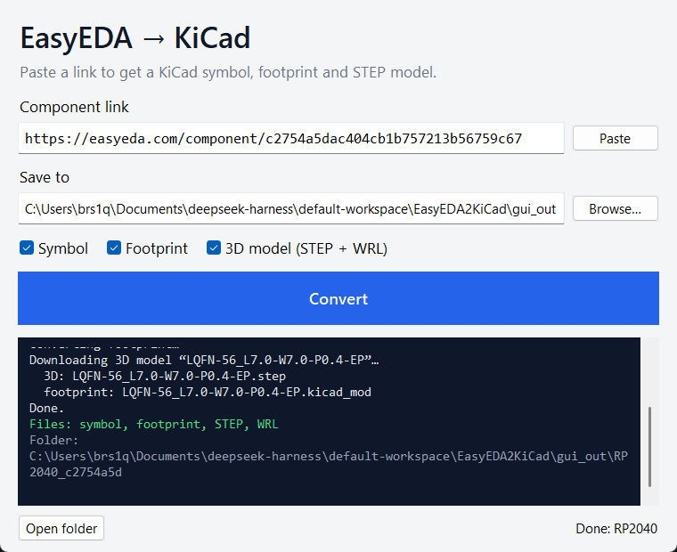

# EasyEDA → KiCad

**Paste a public EasyEDA component link and get a KiCad symbol, footprint and 3D model.**

[](../../releases/latest)
[](LICENSE)

Works with **community components** as well as LCSC/JLCPCB parts — no LCSC part
number required, just the public component URL.



## Why

EasyEDA has a huge component library, but its schematic editor is not for everyone.
This small Windows app extracts a component from a link and hands it to KiCad / Fusion 360:

- **symbol** — a real KiCad library, not a picture;
- **footprint** — pads, holes, silkscreen and courtyard;
- **3D model** — `.step` for Fusion 360 and `.wrl` for the KiCad 3D viewer;
- **symbol ↔ footprint link** is written into the symbol, so Fusion links them
  automatically when both files are imported into the same library.

## Download

Grab the portable build from [Releases](../../releases/latest) →
`EasyEDA2KiCad-portable.zip`.

1. Unpack the archive anywhere.
2. Run `EasyEDA2KiCad.exe`.

No Python and no KiCad installation required. Internet access is needed — the
component is downloaded from EasyEDA.

## Quick start

1. Find the component in the EasyEDA library and open its card (the **i** button).
2. Copy the page URL from the browser:
   `https://easyeda.com/component/0123456789abcdef0123456789abcdef`
3. Paste it into the app, choose an output folder and click **Convert**.
4. In Fusion 360 open your library and click **Import**:
   first the `.kicad_mod` file (footprint), then the `.kicad_sym` file (symbol).
5. Fusion links them automatically — the library now has a component with its
   footprint attached.

The full guide, including the optional STEP attachment and troubleshooting, is in
**[docs/USAGE.md](docs/USAGE.md)**.

## Output

```
DEVEBOX_STM32F407VET6_DEVELOPMENT_BOARD_232c6f96/
├── DEVEBOX_STM32F407VET6_DEVELOPMENT_BOARD.kicad_sym
├── DEVEBOX_STM32F407VET6_DEVELOPMENT_BOARD.pretty/
│   └── DEVEBOX_STM32F407VET6_DEVELOPMENT_BOARD.kicad_mod
└── DEVEBOX_STM32F407VET6_DEVELOPMENT_BOARD.3dshapes/
    ├── <model>.step
    └── <model>.wrl
```

If the component has no symbol or no 3D model, the app creates what is available
and says so in the log.

## Supported links

| Link | Result |
|---|---|
| `https://easyeda.com/component/<32 hex>` | symbol + footprint + 3D (when present) |
| `https://www.easyeda.com/component/<32 hex>` | same |
| bare `<32 hex>` UUID | same |

LCSC/JLCPCB product links (`.../C12345.html`) are not needed: the app works with
the EasyEDA component UUID.

## Limitations

- **Public** components only. Private and corporate libraries will not open.
- Not every community component has a 3D model. The app does not invent one — it
  reports the missing model.
- Fusion does **not** attach STEP automatically; the 3D package is added manually
  in four clicks (see the guide). That is a Fusion limitation, not an app bug.
- The executable is not code-signed, so SmartScreen may ask for confirmation:
  **More info → Run anyway**.
- Not affiliated with EasyEDA, JLCPCB or LCSC. Component data belongs to its
  authors; always check footprints before ordering boards.

## How it works

```
link → UUID → easyeda.com/api/components/<uuid> → component JSON
     → KiCad conversion → .kicad_sym / .kicad_mod / .step / .wrl
```

- `app.py` — Tkinter GUI, no extra UI dependencies.
- `core.py` — fetches the component by UUID and writes the files.
- 2D/3D conversion is done by [easyeda2kicad.py](https://github.com/uPesy/easyeda2kicad.py)
  (AGPL-3.0). The app calls its importers directly, which is why it can work by
  UUID instead of an LCSC number.

## Build from source

Python 3.11+ (tested on 3.12), Windows.

```powershell
python -m venv .venv
.\.venv\Scripts\activate
pip install -r requirements.txt
python app.py
```

Build the portable `.exe` and release archive:

```powershell
.\build.ps1
```

Details: **[docs/BUILD.md](docs/BUILD.md)**.

## License

**GNU AGPL-3.0** — see [LICENSE](LICENSE). This follows from the AGPL-licensed
easyeda2kicad engine: if you publish a build or a modified version, the source
must stay available.

Third-party components: [THIRD_PARTY_NOTICES.md](THIRD_PARTY_NOTICES.md).

## Credits

- [uPesy/easyeda2kicad.py](https://github.com/uPesy/easyeda2kicad.py) — symbol,
  footprint and 3D conversion.
- [wysemon/euc2k.py](https://github.com/wysemon/euc2k.py) — the idea and validation
  of the "community component link → KiCad" approach.
- Everyone who contributes components to the EasyEDA library.

---

[Русская версия](README.ru.md)
