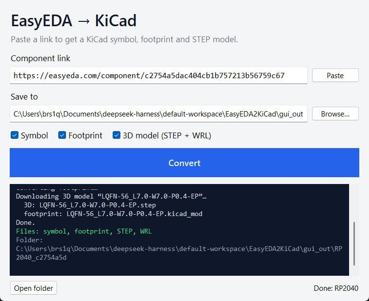

# EasyEDA → KiCad

**Вставьте ссылку на компонент EasyEDA — получите готовые символ, футпринт и 3D-модель для KiCad и Fusion 360.**

[](../../releases/latest)
[](LICENSE)

> **English:** a small Windows GUI that turns a public EasyEDA component link into a KiCad
> symbol (`.kicad_sym`), footprint (`.kicad_mod`) and STEP/WRL 3D model. Works with
> community components — no LCSC part number required. See [Releases](../../releases/latest).



## Зачем это нужно

В библиотеке EasyEDA миллионы компонентов, но рисовать схемы в её редакторе неудобно.
Это приложение выдёргивает компонент по публичной ссылке и отдаёт его в KiCad / Fusion 360:

- **символ** — обычная библиотека KiCad, а не картинка;
- **футпринт** — со всеми падами, отверстиями и шелкографией;
- **3D-модель** — `.step` для Fusion и `.wrl` для просмотра в KiCad;
- **связь символ ↔ футпринт** уже прописана в символе, поэтому в Fusion они
  привязываются друг к другу при импорте.

LCSC-номер не нужен: компоненты сообщества работают так же, как складские.

## Скачать

Готовая сборка для Windows: [Releases](../../releases/latest) → `EasyEDA2KiCad-portable.zip`.

1. Распаковать архив в любую папку.
2. Запустить `EasyEDA2KiCad.exe`.

Python и KiCad для запуска не нужны. Интернет нужен — компонент скачивается с EasyEDA.

## Быстрый старт

1. Найдите компонент в библиотеке EasyEDA и откройте его карточку (кнопка **i**).
2. Скопируйте адрес страницы из браузера — он выглядит так:
   `https://easyeda.com/component/0123456789abcdef0123456789abcdef`
3. Вставьте ссылку в приложение, выберите папку и нажмите **Конвертировать**.
4. В Fusion 360 откройте библиотеку и нажмите **Import**:
   сначала `.kicad_mod` (футпринт), затем `.kicad_sym` (символ).
5. Готово: в библиотеке появится компонент с уже привязанным футпринтом.

Подробнее, с картинками и разбором ошибок: **[docs/USAGE.ru.md](docs/USAGE.ru.md)**.

## Что получается на выходе

```
DEVEBOX_STM32F407VET6_DEVELOPMENT_BOARD_232c6f96/
├── DEVEBOX_STM32F407VET6_DEVELOPMENT_BOARD.kicad_sym
├── DEVEBOX_STM32F407VET6_DEVELOPMENT_BOARD.pretty/
│   └── DEVEBOX_STM32F407VET6_DEVELOPMENT_BOARD.kicad_mod
└── DEVEBOX_STM32F407VET6_DEVELOPMENT_BOARD.3dshapes/
    ├── <модель>.step
    └── <модель>.wrl
```

Если у компонента нет символа или 3D-модели, приложение создаст то, что есть,
и честно напишет об этом в журнале.

## Поддерживаемые ссылки

| Ссылка | Что будет |
|---|---|
| `https://easyeda.com/component/<32 hex>` | символ + футпринт + 3D (если есть) |
| `https://www.easyeda.com/component/<32 hex>` | то же самое |
| просто `<32 hex>` | то же самое |

Ссылки на LCSC/JLCPCB (`.../C12345.html`) этому приложению не нужны — ему
достаточно UUID компонента EasyEDA.

## Ограничения

- Только **публичные** компоненты EasyEDA. Приватные и корпоративные не откроются.
- 3D-модель есть не у всех компонентов сообщества. Если её нет — приложение
  не выдумывает модель, а пишет предупреждение.
- Fusion **не привязывает STEP автоматически** — 3D-пакет добавляется вручную
  (четыре клика, см. инструкцию). Это ограничение Fusion, а не приложения.
- Программа не подписана цифровой подписью, поэтому SmartScreen может
  спросить подтверждение: «Подробнее» → «Выполнить в любом случае».
- Приложение не аффилировано с EasyEDA, JLCPCB или LCSC. Данные компонентов
  принадлежат их авторам; проверяйте футпринты перед заказом платы.

## Как это устроено

```
ссылка → UUID → easyeda.com/api/components/<uuid> → JSON компонента
      → конвертация в KiCad → .kicad_sym / .kicad_mod / .step / .wrl
```

- `app.py` — интерфейс на Tkinter, без внешних зависимостей.
- `core.py` — загрузка компонента по UUID и сборка файлов.
- Конвертация 2D/3D — движок [easyeda2kicad.py](https://github.com/uPesy/easyeda2kicad.py)
  (AGPL-3.0). Приложение обращается к его внутренним импортёрам напрямую, поэтому
  работает по UUID, а не только по LCSC-номеру.

## Сборка из исходников

Нужен Python 3.11+ (проверено на 3.12) и Windows.

```powershell
python -m venv .venv
.\.venv\Scripts\activate
pip install -r requirements.txt
python app.py
```

Сборка `.exe` и архива для Release:

```powershell
.\build.ps1
```

Подробности: **[docs/BUILD.md](docs/BUILD.md)**.

---

[English version](README.md)

## Лицензия

Проект распространяется по **GNU AGPL-3.0** — полный текст в [LICENSE](LICENSE).
Это следствие использования AGPL-движка easyeda2kicad: если вы публикуете
сборку или изменённую версию, исходники должны быть доступны.

Сторонние компоненты и их лицензии: [THIRD_PARTY_NOTICES.md](THIRD_PARTY_NOTICES.md).

## Благодарности

- [uPesy/easyeda2kicad.py](https://github.com/uPesy/easyeda2kicad.py) — конвертация
  символов, футпринтов и 3D.
- [wysemon/euc2k.py](https://github.com/wysemon/euc2k.py) — идея и проверка подхода
  «ссылка на компонент сообщества → KiCad».
- Всем, кто заводит компоненты в библиотеку EasyEDA.
